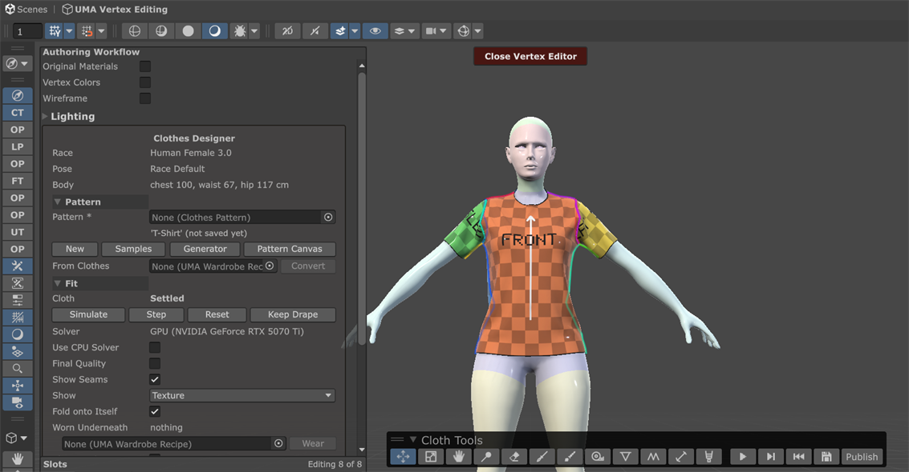

# Clothes Designer: start here

The Clothes Designer makes clothes for a UMA race the way a tailor does. You cut flat pieces, sew them, let them drape on the race's body, pull and pin them into shape, and publish the result as a slot, an overlay and a wardrobe recipe that any character of that race can wear.

The published clothes are ordinary UMA content. A game that uses them does not need this plugin.

## The work in five steps

```
1. Body       2. Pattern        3. Drape       4. Shape         5. Publish
Pick a race   Sample,           Simulate:      Place, Size,     Slot, overlay and
              Generator,        the seams      Grab, Pin,       wardrobe recipe,
              Pattern Canvas    close, the     Fit Brush        then texture them in
              or old clothes    cloth settles                   the Overlay Painter
```

1. **Body.** Choose **UMA > Clothes Designer > Create Clothes on Race...** and pick a race. The designer builds a default body of that race to fit the clothes on. Nothing needs to be in your scene.
2. **Pattern.** Load a sample, draft a garment with the Generator, draw your own on the Pattern Canvas, or convert clothes you already have.
3. **Drape.** Press **Simulate**. The seams pull shut, then the cloth falls onto the body and stops when it is still.
4. **Shape.** Move pieces, resize them, pull and pin the cloth, and paint where it should hug the body.
5. **Publish.** One button saves the slot, the overlay and the wardrobe recipe and shows them on a second character.

## Where do I start?

| I want to... | Go to |
| --- | --- |
| See it work in five minutes | [Quick Start](Clothes%20Designer%20-%20Quick%20Start.md) |
| Learn the designer properly: drape, shape, check and publish | [Tutorial 1: Your First Garment](Clothes%20Designer%20-%20Tutorial%201%20-%20Your%20First%20Garment.md) |
| Draw my own pattern from an empty canvas | [Tutorial 2: A Pattern from Scratch](Clothes%20Designer%20-%20Tutorial%202%20-%20A%20Pattern%20from%20Scratch.md) |
| Get a finished garment from a few sliders | [Tutorial 3: The Garment Generator](Clothes%20Designer%20-%20Tutorial%203%20-%20The%20Garment%20Generator.md) |
| Texture the clothes, with zippers, stitching and piping | [Tutorial 4: Texturing with the Overlay Painter](Clothes%20Designer%20-%20Tutorial%204%20-%20Texturing%20with%20the%20Overlay%20Painter.md) |
| Turn modelled clothes into a pattern, or refit them to another body | [Tutorial 5: Working from Existing Clothes](Clothes%20Designer%20-%20Tutorial%205%20-%20Working%20from%20Existing%20Clothes.md) |
| Make the clothes ready for a game: body shapes, LODs, cloth that moves | [Tutorial 6: Game-Ready Clothes](Clothes%20Designer%20-%20Tutorial%206%20-%20Game-Ready%20Clothes.md) |
| Fix something that went wrong | [Troubleshooting](Clothes%20Designer%20-%20Troubleshooting.md) |

New to the designer? Do the Quick Start, then Tutorial 1. The other tutorials can be done in any order.

## The tutorials

Each tutorial is one job from start to finish, with every button named as it is on screen.

| Tutorial | You make | Time |
| --- | --- | --- |
| [1: Your First Garment](Clothes%20Designer%20-%20Tutorial%201%20-%20Your%20First%20Garment.md) | A T-shirt from a sample, shaped, published and worn by a character | 20 minutes |
| [2: A Pattern from Scratch](Clothes%20Designer%20-%20Tutorial%202%20-%20A%20Pattern%20from%20Scratch.md) | A sleeveless top, drawn, sewn and sized on the Pattern Canvas | 30 minutes |
| [3: The Garment Generator](Clothes%20Designer%20-%20Tutorial%203%20-%20The%20Garment%20Generator.md) | A hoodie and a dress from presets and sliders | 15 minutes |
| [4: Texturing with the Overlay Painter](Clothes%20Designer%20-%20Tutorial%204%20-%20Texturing%20with%20the%20Overlay%20Painter.md) | A jacket with a zipper and stitching painted on it | 25 minutes |
| [5: Working from Existing Clothes](Clothes%20Designer%20-%20Tutorial%205%20-%20Working%20from%20Existing%20Clothes.md) | A pattern from a modelled garment, and a refit for another body shape | 20 minutes |
| [6: Game-Ready Clothes](Clothes%20Designer%20-%20Tutorial%206%20-%20Game-Ready%20Clothes.md) | A skirt with fine folds, LODs, body shapes and cloth that swings | 25 minutes |

## The reference guides

Read these when you need to know what one control does.

- [Pattern Canvas](Clothes%20Designer%20-%20Pattern%20Canvas.md): every tool of the 2D window. Pieces, edges, darts, pleats, lines, tacks, trims, sewing, sizes, UVs and looks.
- [Fitting and Publishing](Clothes%20Designer%20-%20Fitting%20and%20Publishing.md): the drape, placing pieces, fabric, every cloth tool, and everything the bake can make.
- [Garment Generator](Clothes%20Designer%20-%20Garment%20Generator.md): every type, preset and slider.
- [Fit Existing Slot](Clothes%20Designer%20-%20Fit%20Existing%20Slot.md): moving clothing you already have onto another body shape.
- [Troubleshooting](Clothes%20Designer%20-%20Troubleshooting.md): problems by what you see, with the fix.

## Where things are on screen

The designer runs inside UMA's Vertex Editor. While it is open you work in five places:



| Place | What it is for |
| --- | --- |
| **The panel** in the Scene view | The main controls, in the order you use them: Pattern, Fit, Cloth Tools, Fit Report, Publish, Save and Open. |
| **Cloth Tools** toolbar in the Scene view | The same tools as icons, with Simulate, Step, Reset, Keep Drape and **Publish**. |
| **Vertex Editor window** | Details: Body, Body Shape (DNA), Sizes, Fabric and Piece Placement. |
| **Pattern Canvas** window | The flat pattern: draw, sew, cut, add darts and pleats, set sizes and UVs. Open it with **Pattern Canvas** in the panel. |
| **Garment Generator** and **Clothes Samples** windows | Ready-made patterns. Open them with **Generator** and **Samples** in the panel. |

Leave the designer with **Close Vertex Editor** in the Scene view. If you have unsaved work, it asks whether to save the pattern and the fit.

## Words used in these guides

| Word | Meaning |
| --- | --- |
| **Pattern** | The flat pieces, their seams, sizes, fabric and UV layout. Saved as a `ClothesPattern` asset. |
| **Piece** | One flat shape of cloth: a front, a sleeve, a collar. |
| **Edge** | One side of a piece, between two points. An edge is sewn, or it is an opening. |
| **Opening** | An edge that is never sewn: a neckline, an armhole, a hem. Drawn dashed orange. |
| **Seam** | Two edges sewn together. Drawn in one colour on both edges. |
| **Size** | A rule that makes pieces follow the body: the chest plus 8 cm, for example. |
| **Allowance** | The extra a size adds to the body's measurement. Tailors call it ease. |
| **Placement** | Where a piece is laid round the body before it is sewn: which body part, which way it faces, how high. |
| **Fit** | One pattern on one body: the race and body shape, pins, Fit Brush paint, the kept drape and the publish settings. Saved as a `ClothesFit` asset. |
| **Drape** | The shape of the cloth on the body after simulating. |
| **Bake** | Turning the drape into a slot mesh with UVs and bone weights. |
| **Publish** | Bake, save the slot, overlay and wardrobe recipe, add them to the Global Library, and save the pattern and fit. |
| **Try-on** | A second character beside the fitting body, wearing the published clothes through the normal wardrobe. |
| **Mesh Level** | How fine the cloth mesh is: Draft (3 cm), Medium (2 cm), Fine (1.5 cm), Very Fine (1 cm) or Custom. |
| **Layer** | Which piece stays outside where two pieces cross: a pocket over its panel, a belt over a dress. |
| **Look** | A fabric's textures and colour for a piece, baked as an overlay. |
| **Trim** | A zipper, stitching, piping or hem along an edge, painted by the Overlay Painter. |

## What you need

- **Unity 6.3 or newer** and **UMA 3**.
- The **Clothes Designer** plugin, installed from **UMA > Welcome to UMA > Plugins**.
- A race in the UMA Global Library with a base recipe. The UMA 3 humans work as they are.
- Optional: **Clothes Designer Examples** (the sample patterns as assets; the Samples browser has them either way) and the **Overlay Painter** (to texture the clothes and paint trims).

The drape runs on the graphics card. Where the card cannot run compute shaders, the same simulation runs on the CPU, more slowly.

## Where your work is saved

| What | Where | Needed in a game |
| --- | --- | --- |
| Patterns and fits | `Assets/UMAProjectData/ClothesDesigner` by default. You choose the place the first time you save. | No |
| Published slot, overlay, textures and wardrobe recipe | The **Folder** in Publish, by default `Assets/UMAProjectData/ClothesDesigner/Output` | Yes |

Patterns and fits are kept outside the plugin folder, so they survive removing and reinstalling the plugin. Opening them again needs the plugin. The published clothes never do.
