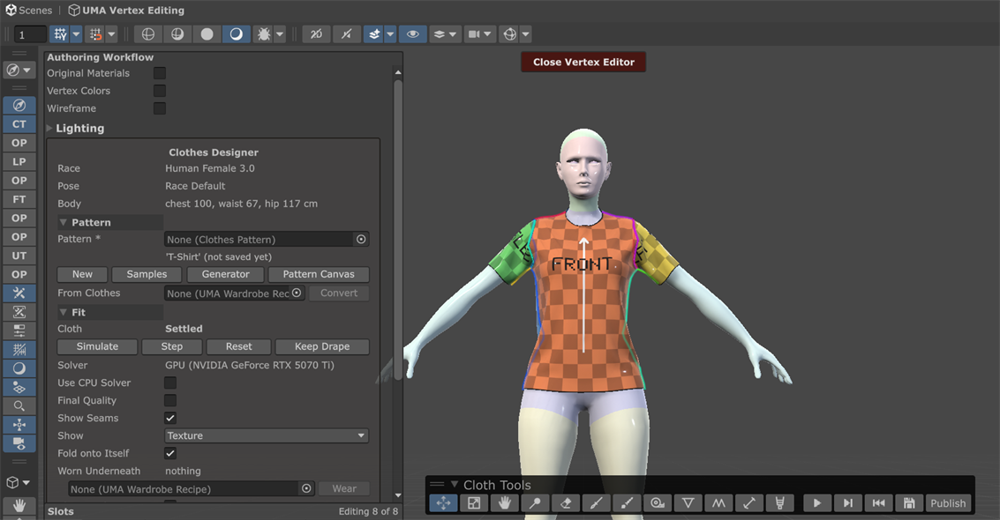

# Clothes Designer quick start

The Clothes Designer makes clothes for a UMA race from sewing patterns. You draw the flat pieces, sew them, drape them on the race's body, pin and pull them into shape, and bake a slot, an overlay and a wardrobe recipe that any character of that race can wear. The baked clothes are ordinary UMA content and work in a game without this plugin.

This page gets you to a first result fast and then maps the panel. For the full set of guides and tutorials, see [Start Here](!Clothes%20Designer%20-%20Start%20Here.md).

## Make your first vest (five minutes)

1. Choose **UMA > Clothes Designer > Create Clothes on Race...**, pick a race (for example *Human Female 3.0*) and press **Create Clothes**. The Vertex Editor opens on that race's default body, standing in **Race Default**, the pose its meshes were modelled in. Nothing needs to be in the scene.
2. In the **Pattern** section of the panel, press **Samples**, select **Sleeveless Vest** and press **Load**. The front and back are laid round the body.
3. In the **Fit** section (or on the **Cloth Tools** toolbar in the Scene view), press **Simulate**. The seams close (*Sewing*), then the cloth falls onto the shoulders (*Settling*). The simulation stops by itself when the cloth is still (*Settled*).
4. Press **Publish** at the end of the **Cloth Tools** toolbar (or **Publish...** in the panel's Publish section). Give the clothes a **Name**, choose the **Wardrobe Region** (*Chest*) and check the **Material**, then press **Publish**.
5. A second character of the race appears beside the body, wearing the vest through the normal wardrobe, and the Scene view turns to it. Press **Arms Raised** and set **Arm Angle** to check it with the arms lifted; the shoulders lift with them, as in an animation.

Publish saved the slot, the overlay and the wardrobe recipe, added them to the Global Library, made the recipe compatible with the character's race, and saved the pattern and the fit. The assets are in the **Folder** shown in Publish (by default `Assets/UMAProjectData/ClothesDesigner/Output`).

After later changes, press **Save Fit** to save them again. **Bake and Try On** in the Publish section bakes with the section's settings without asking and without saving.

Now do [Tutorial 1: Your First Garment](Clothes%20Designer%20-%20Tutorial%201%20-%20Your%20First%20Garment.md) to learn the tools.

## Four ways to get a pattern

| Start from | Press | What you get | Learn it in |
| --- | --- | --- | --- |
| A sample | **Samples** | One of thirty-two ready patterns, from a T-shirt to a hauberk. | [Tutorial 1](Clothes%20Designer%20-%20Tutorial%201%20-%20Your%20First%20Garment.md) |
| The Generator | **Generator** | A garment drafted to this body from a type, a preset and sliders. | [Tutorial 3](Clothes%20Designer%20-%20Tutorial%203%20-%20The%20Garment%20Generator.md) |
| An empty canvas | **New**, then **Pattern Canvas** | One rectangle to shape, copy and sew. | [Tutorial 2](Clothes%20Designer%20-%20Tutorial%202%20-%20A%20Pattern%20from%20Scratch.md) |
| Modelled clothes | **From Clothes**, then **Convert** | A pattern made from a garment's UV islands. | [Tutorial 5](Clothes%20Designer%20-%20Tutorial%205%20-%20Working%20from%20Existing%20Clothes.md) |

### Samples

**Samples** opens the sample browser: the sleeveless vest and thirty-one more, each a tile with a picture of the pattern (its pieces in colours) and of its drape on a body (each piece in the same colour), in groups (Tops, Bottoms, Dresses and Skirts, Underwear and Swim, Accessories, Medieval) with a search field. **Load**, or a double-click, opens one.

The drape pictures ship rendered on Human Female 3.0. **Render on This Body** drapes every sample on the open designer's body in the background (about 10 s a sample) and keeps the pictures for that race in the project's Library.

The samples are T-Shirt, Long-Sleeve Tee, Tank Top, Crop Top, Polo Shirt (its collar turned down over a stand), Forte Shirt (the same shirt with a stand collar), Oxford Shirt, Hoodie, Short Pants, Jeans, Sweatpants, Leggings, Boxer Shorts, Pleated Skirt, A-Line Skirt, Pencil Skirt, Circle Skirt, Sheath Dress, Sundress, Elastic Waist Dress (a thick elastic band gathering the bodice and skirt), Belted Dress (a separate thick belt gathering a loose two-panel dress), Socks, Beanie, Face Mask, Bra, Swimsuit, Briefs, and medieval clothes: a Hauberk (mail, in the heavy **Mail** fabric), Leather Armor, a Tunic and a Coif.

Each is drafted for the default *Human Female 3.0* and sized for other bodies by its pattern's sizes (chest, waist, hips, arm, leg and head). On a body far from that one (the default male, for example) tops fit more loosely and skirts sit lower. The same patterns are saved as assets in **Clothes Designer Examples** (`Assets/UMA/ClothesDesignerExamples/Patterns`).

### The Generator

**Generator** opens the garment generator: pick a type (top, dress, kimono, trousers, skirt, jumpsuit) and a preset, press **Generate**, and move the sliders for length, fit, neckline, collar, sleeves, front and bands. The garment is drafted to this body's measurements and drapes as you go. See [Garment Generator](Clothes%20Designer%20-%20Garment%20Generator.md).

### A new pattern

**New** starts a pattern with one piece, a rectangle 50 cm wide and 60 cm tall. **Pattern Canvas** opens the 2D window where you shape it, add more pieces and sew them. See [Pattern Canvas](Clothes%20Designer%20-%20Pattern%20Canvas.md).

### Modelled clothes

**From Clothes** takes a wardrobe recipe the race can wear and makes a pattern from it: each UV island becomes a piece, at its true size, turned upright and placed round the body part it is worn on. The islands are sewn where they meet, and free edges become openings. Folds modelled into the mesh are measured and taken out of the pieces' size, so the simulation can make its own. The pieces keep the clothes' UVs, so their textures still fit. Press **Convert**; what was found is listed under it.

Game clothes are not cut like sewing patterns: expect slivers, islands that do not line up with real seams, and stretches the converter cannot pair (it says how many). Tidy the result on the Pattern Canvas (sew what is open, join or delete small pieces) before simulating. A pattern made by the Clothes Designer itself converts back to the same pieces and seams.

## Other ways to open the designer

Select a race, a scene character, a slot or a wardrobe recipe and choose **Editors > Plugins > Clothes Designer** above its inspector:

| You selected | What opens |
| --- | --- |
| A race | The designer on that race's default body. |
| A scene character | The designer on the default body of the character's race. The character in your scene is not changed. |
| A clothing slot or wardrobe recipe | **Fit Existing Slot** for that clothing, on a race that wears it (you are asked when the clothing does not say). See [Fit Existing Slot](Clothes%20Designer%20-%20Fit%20Existing%20Slot.md). |

Opening the Vertex Editor in the usual way (**Open Vertex Editor** on a character) never starts in the designer. Inside the Vertex Editor, **Clothes Designer** is the button on the second row of the workflow bar, under Sculpt, Vertex Paint, Advanced and Blendshapes. Once the designer is open, the workflow bar is hidden: the designer's own tools do everything it needs, and you leave it by closing the Vertex Editor, or with **Publish and Sculpt**, which opens Sculpt on the baked slot.

## The panel, top to bottom

The panel in the Scene view follows the order of the work.

| Section | What is in it |
| --- | --- |
| **Race, Pose, Body** | The body the clothes are fitted to and its chest, waist and hip measurements (taken round the body with the arms left out). |
| **Pattern** | The pattern being fitted, and **New**, **Samples**, **Generator**, **Pattern Canvas** and **From Clothes**. A `*` means unsaved changes. |
| **Fit** | **Simulate** / **Pause**, **Step**, **Reset**, **Keep Drape**, the solver, the views and the Mesh Level. |
| **Cloth Tools** | The tools that work on the cloth in the Scene view. |
| **Fit Report** | Open seams, cloth inside the body, stretch, and the time per frame. |
| **Publish** | **Publish...**, every bake setting, **Bake and Try On**, **Publish and Sculpt**, and the try-on controls. |
| **Save and Open** | **Save Pattern**, **Save Pattern As**, **Save Fit**, **Save Fit As**, **Open Fit**. |

The Cloth Tools, Fit Report and Publish sections appear once the cloth is built.

### Fit

- **Simulate** / **Pause**, **Step** (one frame), **Reset** (back to the pieces laid out, unsewn) and **Keep Drape** (remember this shape in the fit: reopening it restores these folds). The same four are on the Cloth Tools toolbar in the Scene view (play/pause, step, rewind and save icons).
- **Solver** says whether the GPU or the CPU runs the drape; **Use CPU Solver** switches. **Final Quality** uses more substeps.
- **Show Seams** draws each seam and its threads. **Show** colours the cloth by its texture, its stretch or its distance from the body. **Show Back Faces** draws the inside of the cloth too.
- **Fold onto Itself** keeps a piece from passing through itself.
- **Worn Underneath** puts clothes on the body to drape these over.
- **Mesh Level** sets how fine the cloth mesh is; the vertex and triangle counts are shown under it. **Mesh Topology** chooses even triangles or a grid along the grain.

### Cloth Tools

The same tools are on the **Cloth Tools** toolbar in the Scene view (hover one for what it does), shown while the cloth is ready. Close it from the Scene view's overlay menu if you prefer the panel; it comes back the next time the designer opens.

| Tool | What it does |
| --- | --- |
| **Place** | Click a piece and drag it round the body or up and down. Shift-drag moves it out from the body. Its Body Part, Faces, top, Distance, Across, Lay Flat and Freeze are shown to type in. |
| **Size** | Click a piece and drag its red side handles or green hem handle to make it wider or longer, or type its Width and Length. The cloth shows the new size as you drag and settles into it when you let go. |
| **Grab** | Drag the cloth. Escape puts it back. One drag is one Undo step. |
| **Pin** and **Erase Pin** | Hold cloth where it is, with a radius and strength. Pins can follow the body or hold a point in space. |
| **Fit Brush** | Paint where the cloth hugs the body, smooths out, puffs up, slims in, stiffens or gets heavier. |
| **Roll** | Drag over cloth that sinks into the cloth behind it, such as a collar's leaf on its stand, to lift it clear. |
| **Measure** | The distance between two points, and how far round the cloth and the body are. |
| **Dart** and **Pleat** | Add a dart or a pleat on the cloth where it is worn. |
| **Draw Piece** | Click the outline of a new piece on the body's torso. |
| **Body Region** | Paint an area on the body and press **Make Pieces** to get sewn pieces that cover it. |

Each tool is described under *Shaping the cloth* in [Fitting and Publishing](Clothes%20Designer%20-%20Fitting%20and%20Publishing.md#shaping-the-cloth).

### Publish

Name, material, wardrobe slot and folder; *Hide Body Underneath* (a mesh hide for fully covered body triangles); *UV Check Texture*; **Inside Facing** and **Rim** (cloth inside the openings, so one-sided materials do not show through); **Slot Mesh Level** and **Normal Map from Drape** (drape at a fine Mesh Level, bake a lighter slot that keeps the small folds in a normal map); **Full Thickness**; **LOD Slots**; **Buttons and Parts**; **Topstitching**; **Piece Looks**; **Body Shapes**; **Cloth Motion**; and **Bake and Try On**. The try-on can play an animation clip. [Tutorial 6](Clothes%20Designer%20-%20Tutorial%206%20-%20Game-Ready%20Clothes.md) walks through them.

### The Vertex Editor window

The Vertex Editor window shows more: the body's measurements, **Body Shape (DNA)** to fit on another shape, **Sizes** with what each size works out to on this body and its allowance, **Fabric** (each piece's fabric, plus this fit's damping, clearance, cloth thickness and bone weights) and **Piece Placement**. A piece's fabric and placement are also in the Pattern Canvas's side panel.

## Keys and mouse

| Where | Action | Result |
| --- | --- | --- |
| Scene view | Alt-drag | Orbits the view, whatever tool is chosen. |
| Any drag on the cloth | Escape | Puts the cloth or the piece back. |
| Place | Shift-drag up or down | Moves the piece out from or in towards the body. |
| Place, on an arm or leg | Ctrl-drag; Ctrl+Shift-drag | Tilts the piece; moves its far end in or out. |
| Size | Shift-drag | Keeps the piece's proportions. |
| Fit Brush | Ctrl-drag | Takes that paint off. |
| Dart | Shift-drag | A double-pointed dart from one point to the other. |
| Draw Piece | Enter; Backspace; Escape | Finishes the piece; takes the last point back; starts again. |
| Body Region | Shift-drag | Takes the paint off. |
| Pattern Canvas | Scroll; middle-drag or Alt-drag | Zooms; pans. |
| Pattern Canvas | Double-click an edge | Adds a point there. |
| Pattern Canvas | Shift while dragging a point | Snaps to whole centimetres. |
| Pattern Canvas | Shift as you press | Moves the whole piece. |
| Pattern Canvas | Ctrl while dragging | Keeps the move to one axis. |
| Pattern Canvas | Arrow keys; Shift+arrow keys | Nudges the selection 1 mm; 1 cm. |
| Pattern Canvas | Ctrl+D | Duplicates what is selected. |
| Pattern Canvas | Delete | Removes the selected point, dart, pleat, line, tack or part. |
| Pattern Canvas, Sew | Shift-click more edges, then Enter | Sews one edge to several. |
| Pattern Canvas, Draw | Enter or double-click; Backspace; Escape | Finishes the line; takes the last point back; cancels. |

On a Mac, use Cmd where this says Ctrl.

## Good to know

- Clothes are weighted on the body exactly as shown. Fit on the race's default shape for clothes every character can wear; for another body shape, change the DNA, drape again and save a fit for that shape, or bake **Body Shapes**.
- Fit at *Draft* or *Medium* and raise the Mesh Level before baking: the drape is carried over to the finer mesh. For small folds on a light slot, drape at a fine level and set a coarser **Slot Mesh Level** with **Normal Map from Drape**.
- The baked clothes are single-sided cloth. **Inside Facing** (on by default) lines the openings so a one-sided material still shows cloth there; or choose a material that draws both faces.
- Baking again updates the same slot, overlay and recipe. Their GUIDs stay, so recipes, libraries and scenes that use them keep working. Textures painted on the overlay and anything added to the recipe are kept; edits made to the slot's mesh are replaced.
- Leaving the Vertex Editor with unsaved work asks whether to save the pattern and fit.

## If something goes wrong

The five most common problems:

- **"A body for the race could not be built."** The race has no base recipe, or the recipe refers to slots that are not in the UMA Global Library.
- **Some cloth starts inside the body.** The pieces are moved further out automatically, 2 cm at a time, while that frees more points; the message names the pieces still inside. If it stays (it says moving further out did not free them), move those pieces with the **Place** tool, or raise their *Above Shoulders* or *Distance*: a piece with a negative Distance stays as close to the body however far out the rest are laid.
- **A seam twists or gathers.** Open the Pattern Canvas: dotted lines join the sewn ends. If they cross, select the edge and press **Reverse**.
- **"... leaves the texture" or "... overlap in the texture".** The pattern was redrawn larger. In the Pattern Canvas, UVs tab, press **Repack UVs**.
- **The Simulate button runs on the CPU and is slow.** This graphics card cannot run compute shaders, or *Use CPU Solver* is on. Lower the Mesh Level while fitting.

Everything else is in [Troubleshooting](Clothes%20Designer%20-%20Troubleshooting.md).
