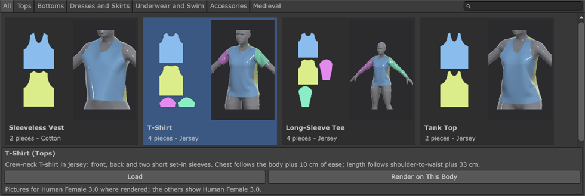
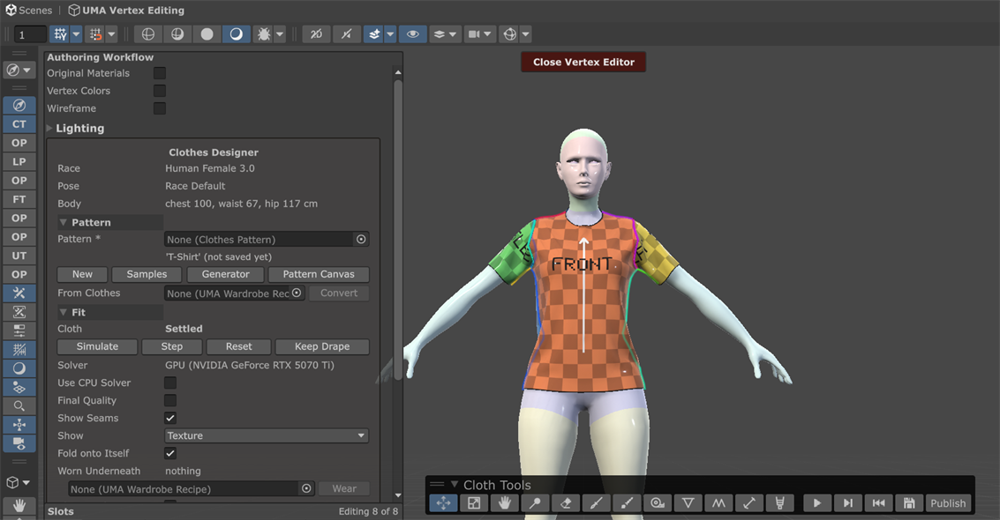
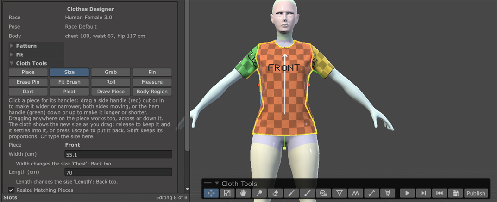
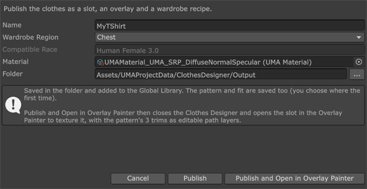

# Tutorial 1: your first garment

In this tutorial you take a sample T-shirt from flat pieces to a wardrobe recipe on a character. You learn the whole designer on the way: draping, the views, the cloth tools, sizes, fabric, publishing and the try-on.

**Time:** about 20 minutes. **You need:** the Clothes Designer installed and the UMA 3 humans in the Global Library.

Other guides: [Start Here](!Clothes%20Designer%20-%20Start%20Here.md), [Fitting and Publishing](Clothes%20Designer%20-%20Fitting%20and%20Publishing.md) (the reference for everything on this page).

## What you will make

A crew-neck jersey T-shirt for *Human Female 3.0*: a front, a back and two short sleeves, a little longer and looser than the sample, published to the *Chest* wardrobe region.

## Step 1: open the designer on a race

1. Choose **UMA > Clothes Designer > Create Clothes on Race...**.
2. Pick **Human Female 3.0** in the list and press **Create Clothes**.

The Vertex Editor opens on a default body of the race. The panel in the Scene view shows three lines at its top:

- **Race**: the race the clothes are for.
- **Pose**: *Race Default*, the pose the race's meshes were modelled in. Clothes are fitted and weighted in this pose.
- **Body**: the chest, waist and hip measurements, taken round the body with the arms left out.

> **Tip:** nothing needs to be in your scene, and nothing in your scene is changed. The body is a temporary character that exists only while the designer is open.

## Step 2: load the sample

1. In the panel's **Pattern** section, press **Samples**. The **Clothes Samples** window opens: each sample is a tile with a picture of its pattern and of its drape.
2. Select **T-Shirt** (in the *Tops* group) and press **Load**. A double-click on the tile does the same.

The four pieces are laid round the body, a little larger than it: the front and back round the torso, each sleeve round its arm. The Scene view turns to them. The **Fit** section says *Cloth: Laid out round the body*.

Look round the body as in any Scene view: Alt-drag orbits, the scroll wheel zooms.

## Step 3: drape it

1. In the **Fit** section, press **Simulate** (or the play icon on the **Cloth Tools** toolbar in the Scene view).
2. Watch the **Cloth** line. It reads *Sewing* with a percentage while the seams pull shut, then *Settling* while the cloth falls onto the shoulders, then *Settled*. The simulation stops by itself.

While it sews, each seam is drawn in its own colour, with a thread from each point to the point it is sewn to. The threads shorten and disappear as the seam closes. Turn this off with **Show Seams** if it is in your way.

| Button | What it does |
| --- | --- |
| **Simulate** / **Pause** | Starts and stops the simulation. |
| **Step** | Simulates one frame. |
| **Reset** | Puts the pieces back as they were laid out, unsewn. |
| **Keep Drape** | Remembers this shape in the fit, so opening the fit later restores these exact folds. |

## Step 4: check the fit

1. Open the **Fit Report** section (it is closed at first). A good drape shows:
   - **Open seams**: 0 to a few millimetres at most. Publishing welds every seam shut whatever this says.
   - **In the body**: *none*.
   - **Stretch**: a small average. A few percent at the shoulders is normal.
2. In the **Fit** section, set **Show** to **Stretch**. Blue cloth is not stretched, green is 5%, yellow 10%, red 20% or more.
3. Set **Show** to **Body Distance**. Green cloth is at its normal distance from the skin, blue stands off 3 cm or more, red is inside the body.
4. Set **Show** back to **Texture**. This view draws each piece's outline, grain and name, which is also what the UV check texture will show.

## Step 5: shape it with the cloth tools

The tools are in the panel's **Cloth Tools** section and on the **Cloth Tools** toolbar. Both show the same tool. Hover over a button to read what it does.

**Make it longer with Size.**

1. Choose **Size** and click the front of the shirt. Three handles appear on the cloth: a red one at each side and a green one at the hem.
2. Drag the green hem handle down about 5 cm. The cloth shows the new length while you drag. A label at the pointer shows the new width and length.
3. Let go. The pattern changes, and the cloth simulates into the new size.

The back grew too. The T-shirt's length is set by one of the pattern's **sizes**, which both pieces share, so the Size tool changed that size. The panel says which size sets each measurement.

**Pull the cloth with Grab.**

1. Choose **Grab**. Set **Radius (cm)** to about 10.
2. Drag the hem at one side outwards and let go. The cloth follows the pointer, then settles again.
3. Press **Ctrl+Z**. One drag is one Undo step. **Escape** during a drag also puts the cloth back.

**Hold the cloth with Pin.**

1. Choose **Pin** and leave **Pins Follow** on **Body**.
2. Click on the cloth at the top of one shoulder. That cloth now stays there while the rest simulates.
3. Choose **Erase Pin** and click the same place to release it, or press **Clear Pins**.

**Measure it.**

1. Choose **Measure** and click two points on the cloth, for example the neckline and the hem.
2. The panel shows the **Distance**, how far **Round the Cloth** and **Round the Body** it is at the first point's height, and the **Ease** between them.

> **Tip:** there are more tools: **Place** moves a piece round the body before sewing, **Fit Brush** paints where the cloth hugs the body, **Roll** lifts cloth that sinks into the cloth behind it. They are all described under *Shaping the cloth* in [Fitting and Publishing](Clothes%20Designer%20-%20Fitting%20and%20Publishing.md#shaping-the-cloth).

## Step 6: make it looser with the sizes

The panel in the Scene view holds what you use all the time. The **Vertex Editor window** holds the details: **Body**, **Body Shape (DNA)**, **Sizes**, **Fabric** and **Piece Placement**.

1. Open **Sizes**. Each size shows what it works out to on this body. **Chest** reads the body's chest plus its allowance, per piece.
2. Change the **Allowance (cm)** under **Chest** from 10 to 16 and press Enter. The pieces are cut wider and laid out again.
3. Press **Simulate**.

A larger allowance is a looser shirt. This allowance is kept in the fit, not the pattern, so the sample itself stays as it was.

## Step 7: change the fabric

1. In the Vertex Editor window, open **Fabric**. Every piece has its own fabric. The T-shirt's pieces are **Jersey**.
2. Change **Front** to **Silk**. The cloth carries on from the same shape and falls into finer, limper folds.
3. Change it back to **Jersey**.

To change every piece at once, set the first piece and press **Use the First Piece's Fabric for All**.

## Step 8: save your work

1. In the **Fit** section, press **Keep Drape** if you want these exact folds back when you open the fit later.
2. In the **Save and Open** section, press **Save Pattern**. The first time, you choose where. Name it *My T-Shirt*.
3. Press **Save Fit**. The fit holds the race, the body shape, the allowances you changed, the pins, the kept drape and the publish settings.

A `*` beside **Pattern**, **Save Pattern** or **Save Fit** means there are unsaved changes.

## Step 9: publish

1. Press **Publish** at the end of the **Cloth Tools** toolbar, or **Publish...** at the top of the panel's **Publish** section. The **Publish Clothes** window opens.
2. Set:
   - **Name**: *MyTShirt*. The slot, the overlay and the wardrobe recipe are named after it.
   - **Wardrobe Region**: *Chest*. A character wears one recipe in each region, so this also says what the shirt replaces.
   - **Material**: the UMA material the shirt is drawn with. One is chosen for you.
   - **Folder**: where the assets are saved.
3. Press **Publish**.

The second button, **Publish and Open in Overlay Painter**, is there only when the Overlay Painter is installed; [Tutorial 4](Clothes%20Designer%20-%20Tutorial%204%20-%20Texturing%20with%20the%20Overlay%20Painter.md) uses it.

The designer bakes the drape into a slot, writes the overlay and the wardrobe recipe, adds all three to the Global Library, makes the recipe compatible with *Human Female 3.0*, and saves the pattern and the fit.

> **Note:** Publish needs a drape. If it says *Simulate until the seams are sewn and the cloth hangs, then publish*, press **Simulate** and wait for *Settled*.

## Step 10: try it on

A second character appears beside the fitting body, wearing the shirt through the normal UMA wardrobe. The Scene view turns to it.

1. Press **Arms Raised** in the **Publish** section, and move **Arm Angle (deg)**. The shoulders lift with the arms as they do in an animation. Watch the armholes and the hem: this is how well the bone weights follow the body.
2. Drag an animation clip into **Try-On Animation** and scrub **Time (s)**, or press **Play**.
3. **View Fitting Body** and **View Try-On** point the Scene view at either character.

The shirt shows a checked texture with each piece's name on it. That is the **UV Check Texture**: 5 cm checks measured on the cloth, each piece's outline, grain and name. It shows that a texture will land the right way round. [Tutorial 4](Clothes%20Designer%20-%20Tutorial%204%20-%20Texturing%20with%20the%20Overlay%20Painter.md) replaces it with a real texture.

## Step 11: use it on your own character

1. Press **Select Recipe** in the **Publish** section. The wardrobe recipe is selected in the Project window.
2. Close the designer with **Close Vertex Editor** in the Scene view.
3. Put the recipe on a character as you would any UMA wardrobe recipe: add it to a Dynamic Character Avatar's default wardrobe recipes, or call `avatar.SetSlot(recipe)` and `avatar.BuildCharacter()` at run time.

## Changing it later

1. Open the designer on the race again.
2. In **Save and Open**, drag your saved fit into **Open Fit**. The pattern, the sizes, the pins and the kept drape come back.
3. Change what you like and press **Publish** again under the same name.

Publishing again updates the same slot, overlay and recipe. Their GUIDs stay, so every recipe, library and scene that uses them keeps working. Textures on the overlay and anything you added to the recipe are kept. The slot's mesh is replaced.

## What you learned

- Clothes start as flat pieces laid round a default body of the race.
- **Simulate** sews and drapes them. The **Fit Report** and the **Show** views tell you whether the fit is good.
- **Size**, **Grab**, **Pin** and **Measure** work on the cloth where it is worn.
- **Sizes** and **Fabric** are in the Vertex Editor window.
- **Publish** makes the slot, the overlay and the wardrobe recipe in one step, and the try-on shows them worn.

## Next

- Draw your own pieces: [Tutorial 2: A Pattern from Scratch](Clothes%20Designer%20-%20Tutorial%202%20-%20A%20Pattern%20from%20Scratch.md).
- Skip the drawing: [Tutorial 3: The Garment Generator](Clothes%20Designer%20-%20Tutorial%203%20-%20The%20Garment%20Generator.md).
- Something looks wrong: [Troubleshooting](Clothes%20Designer%20-%20Troubleshooting.md).
