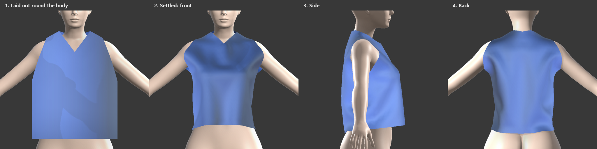
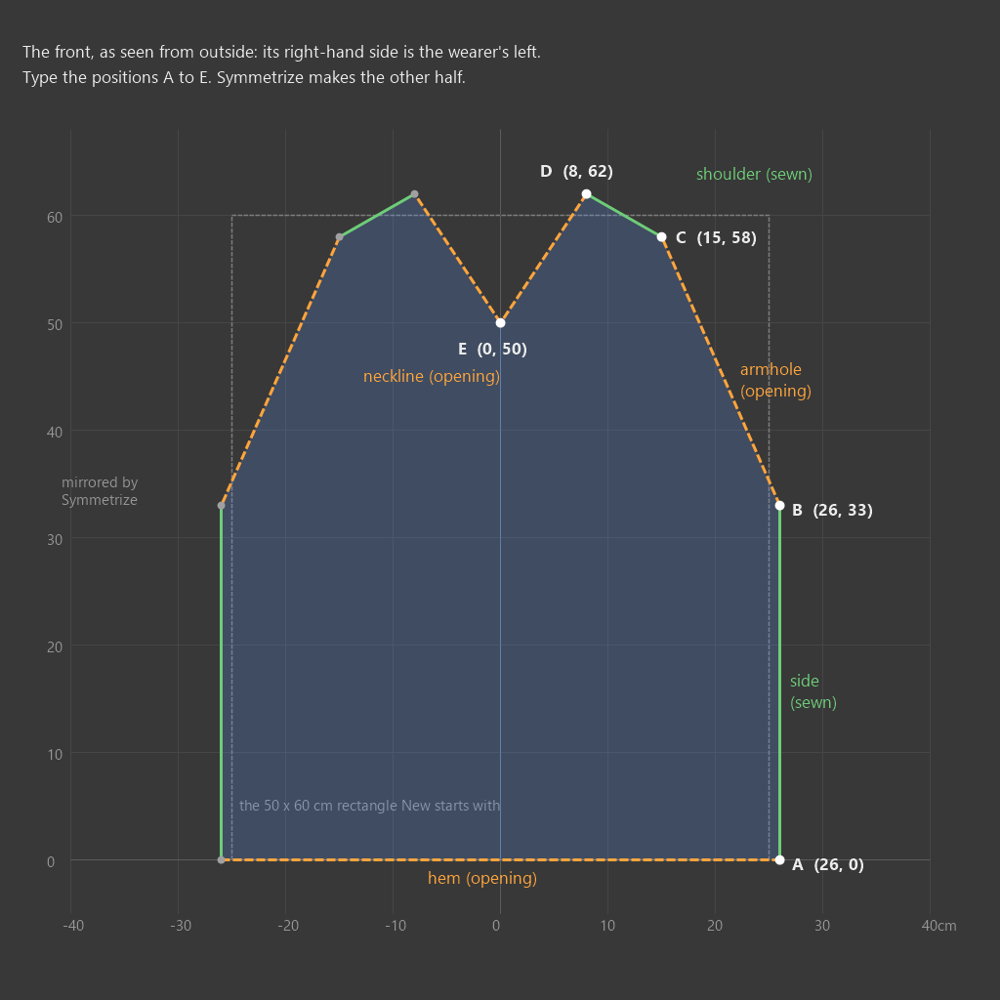
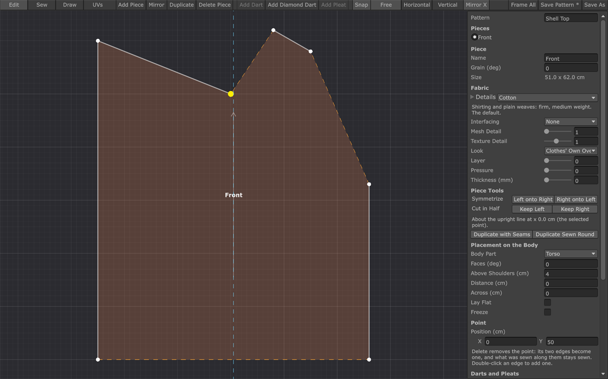
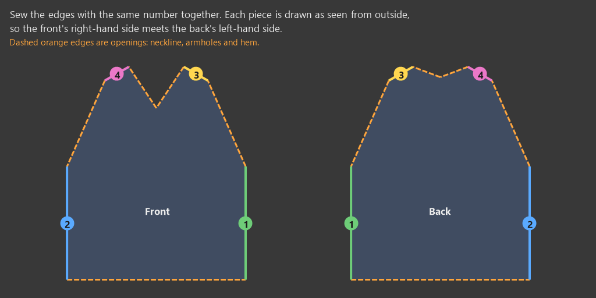
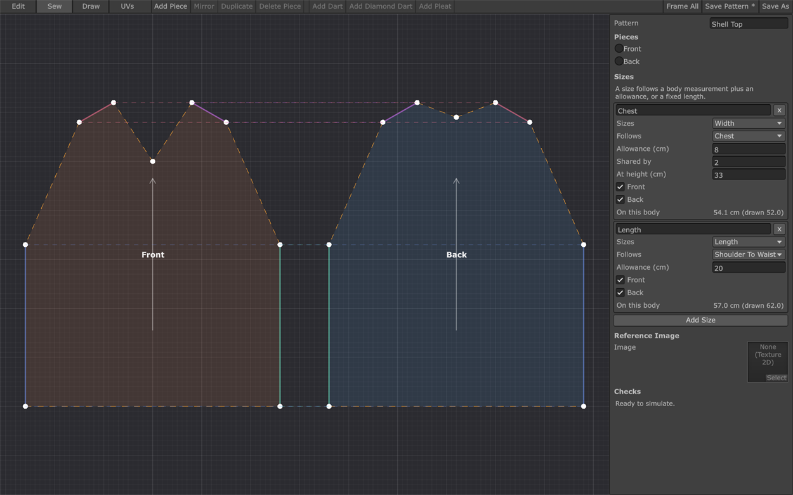

# Tutorial 2: a pattern from scratch

In this tutorial you draw a sleeveless top on an empty canvas: you shape one rectangle into a front, copy it for the back, sew the two together, and give the pattern sizes so it fits any body. Every number in it was draped on *Human Female 3.0* and *Human Male 3.0* before it was written down.

**Time:** about 30 minutes. **You need:** [Tutorial 1](Clothes%20Designer%20-%20Tutorial%201%20-%20Your%20First%20Garment.md), or to know how to open the designer and press Simulate.

Other guides: [Start Here](!Clothes%20Designer%20-%20Start%20Here.md), [Pattern Canvas](Clothes%20Designer%20-%20Pattern%20Canvas.md) (the reference for every tool used here).

## What you will make

A front and a back, sewn at the shoulders and the sides, open at the neck, the armholes and the hem.

## Three rules before you draw

1. **Pieces are drawn in centimetres, as seen from outside the garment.** So the front's right-hand side on the canvas is the wearer's left.
2. **Every edge is sewn, or it is an opening.** A neckline, an armhole and a hem are openings. The canvas draws openings dashed orange and seams in colour.
3. **Where a piece lies on the canvas does not change the cloth.** Its **placement** says where it is laid on the body. Move pieces about the canvas as you like.

## Step 1: start a new pattern

1. Choose **UMA > Clothes Designer > Create Clothes on Race...**, pick **Human Female 3.0** and press **Create Clothes**.
2. In the panel's **Pattern** section, press **New**.

A pattern named *New Pattern* starts with one piece, a rectangle 50 cm wide and 60 cm tall, laid on the front of the body.

3. Press **Pattern Canvas**. The canvas window opens with the rectangle on a 1 cm grid, with a stronger line every 10 cm.
4. In the side panel, type *Shell Top* in the **Pattern** field.
5. Click inside the rectangle to select it. Under **Piece**, change its **Name** to *Front*.

Scroll to zoom, middle-drag (or Alt-drag) to pan, and press **Frame All** to see everything.

## Step 2: shape the right half of the front

You only shape the right half. Step 4 mirrors it onto the left.

To set a point exactly, click it and type its **Position (cm)** in the side panel. It is under **Point**, below the piece's own settings, so scroll the side panel down if you do not see it. **Double-click an edge** to add a point there; the new point is selected, ready for its position.

| Point | How to make it | Position (cm) |
| --- | --- | --- |
| **E**, the centre of the neck | Double-click the top edge near its middle | X 0, Y 50 |
| **D**, the neck point | Double-click the top edge between E and the top right corner | X 8, Y 62 |
| **C**, the shoulder tip | Click the top right corner | X 15, Y 58 |
| **B**, the underarm | Double-click the right edge | X 26, Y 33 |
| **A**, the hem corner | Click the bottom right corner | X 26, Y 0 |

The left half still looks like the old rectangle. That is expected.

> **Tip:** you can drag points instead of typing. Hold **Shift** after you start dragging to snap to whole centimetres. The numbers do not have to be exact: the sizes in Step 8 fit the pieces to the body.

## Step 3: mark the openings

1. Click the **hem** (the bottom edge). In the side panel, under **Edge**, turn on **Opening**.
2. Click the **armhole** (from B to C) and turn on **Opening**.
3. Click the **neckline** (from D to E) and turn on **Opening**.

Each turns dashed orange. The shoulder (C to D) and the side (A to B) stay as they are: they will be sewn.

> **Tip:** for a rounder armhole, turn on **Curved** on the armhole edge too, and drag the two blue handles in the canvas. The curve is mirrored with the rest in the next step.

## Step 4: mirror the right half onto the left

1. Click point **E**, the centre of the neck. The mirror line goes through the selected point.
2. In the side panel, under **Piece Tools**, find **Symmetrize** and press **Right onto Left**.

The piece becomes the mirror image of its right half, still one piece, with its openings mirrored too. The line under the buttons says which line it mirrors about: *x 0.0 cm*.

The front is finished: nine points, five openings (the hem, two armholes, the two halves of the neckline) and four edges left to sew.

## Step 5: make the back

1. With the front selected, press **Duplicate** on the toolbar. A copy named *Front Copy* appears beside it.
2. Change its **Name** to *Back*.
3. Click the copy's centre neck point and change the **Y** of its **Position (cm)** from 50 to 59. A back neckline is shallow.
4. Click inside the back to select the piece. Under **Placement on the Body**, set **Faces (deg)** to **180**.

**Faces** is the direction round the body: 0 is the front, 180 the back, 90 the body's left. The copy came with the front's placement, so without this step both pieces would be laid on the front of the body.

In the Scene view, the back is now laid behind the body.

## Step 6: sew

1. Choose **Sew** on the toolbar.
2. Click the front's **right side** edge, then the back's **left side** edge. Both take the same colour: that is a seam.
3. Click the front's **left side**, then the back's **right side**.
4. Click the front's **right shoulder**, then the back's **left shoulder**.
5. Click the front's **left shoulder**, then the back's **right shoulder**.
6. Choose **Edit** on the toolbar to leave Sew mode.

Right meets left because both pieces are drawn from outside: walk round the body from the front to the back and the front's right-hand edge arrives at the back's left-hand edge.

Dotted lines join the ends that meet. If the two dotted lines of a seam cross, the seam is twisted: select either edge and press **Reverse**.

Now look at **Checks** at the bottom of the side panel. It should say **Ready to simulate.** If it says *edges are neither sewn nor marked as openings*, an edge was missed: click each edge of the outline and look for one that is neither orange nor coloured.

## Step 7: drape it

1. Go back to the Scene view. The two pieces are laid round the body.
2. Press **Simulate** in the panel's **Fit** section and wait for *Settled*.
3. Open **Fit Report**: **Open seams** should read 0.0 mm and **In the body** *none*.

You have made clothes from an empty canvas.

> **Note:** if the cloth twists across the chest and bunches at the waist, a side was sewn to the wrong edge: right to right instead of right to left. In the Pattern Canvas, select the edge, press **Unsew**, and sew it again as in Step 6.

## Step 8: add sizes, so it fits every body

The top is drawn 52 cm wide for a 100 cm chest. On a bigger body it would be tight. A **size** makes pieces follow a body measurement.

In the Pattern Canvas side panel, scroll to **Sizes**.

**The chest.**

1. Press **Add Size**. Type *Chest* in its name field.
2. Leave **Sizes** on *Width* and **Follows** on *Chest*.
3. Set **Allowance (cm)** to **8**. This is the ease: the room between the body and the cloth.
4. Leave **Shared by** on **2**: a front and a back go round the chest together.
5. Set **At height (cm)** to **33**, the underarm line on your pieces.
6. Tick **Front** and **Back**.

The line *On this body* shows the result: 54.1 cm for each piece on Human Female 3.0 (the 100 cm chest plus 8, shared by two), against the 52 cm you drew.

**The length.**

1. Press **Add Size** again. Type *Length*.
2. Set **Sizes** to *Length* and **Follows** to *Shoulder To Waist*.
3. Set **Allowance (cm)** to **20**: the hem falls 20 cm below the waist.
4. Tick **Front** and **Back**.

> **Note:** **At height** is a height on the canvas grid. Draw pieces that share a size at the same height, with their hems on the same line, as the front and the back are here.

Press **Simulate** again. On Human Female 3.0 the top is now 4% wider and 8% shorter than drawn. On Human Male 3.0, with his 115 cm chest, the same pattern is cut 18% wider.

| Body | Chest | Each piece is cut | Open seams | In the body |
| --- | --- | --- | --- | --- |
| Human Female 3.0 | 100 cm | 54.1 cm wide, 57.0 cm long | 0.0 mm | none |
| Human Male 3.0 | 115 cm | 61.3 cm wide, 57.9 cm long | 0.0 mm | none |

## Step 9: save and publish

1. In the panel's **Save and Open** section, press **Save Pattern** and choose where.
2. Press **Publish** on the Cloth Tools toolbar. Give it a **Name**, choose the **Wardrobe Region** (*Chest*) and press **Publish**.

The try-on character wears your top. Press **Arms Raised** to check the armholes.

## Make it your own

Try these on the Pattern Canvas. The cloth on the body is rebuilt after every change.

- **A scoop neck.** Select a neckline edge and turn on **Curved**, then drag its handles. With **Mirror X** on (toolbar), the other half follows.
- **A longer top.** Change the *Length* size's allowance from 20 to 35.
- **A different fabric.** Select a piece and choose a **Fabric**: *Silk* falls in fine folds, *Denim* hangs stiff. See [Fabric](Clothes%20Designer%20-%20Fitting%20and%20Publishing.md#fabric).
- **Shape at the waist.** Select a piece and press **Add Diamond Dart**. With Mirror X on you get a mirrored pair. See [Darts](Clothes%20Designer%20-%20Pattern%20Canvas.md#darts).
- **Keep both halves the same from now on.** Turn on **Mirror X**: moving a point moves its mirror image.

## Other ways to make a piece

- **Add Piece** on the canvas toolbar adds another rectangle to shape.
- **Mirror** adds a left-right mirrored copy that follows every change to the original: draw one sleeve and get the other.
- **Draw Piece** (Cloth Tools, in the Scene view) lets you click a piece's outline directly on the body's torso.
- **Body Region** (Cloth Tools) lets you paint an area on the body and press **Make Pieces**: the area is cut open, unrolled flat and sewn for you. Good for close-fitting clothes.

Both are described under *Shaping the cloth* in [Fitting and Publishing](Clothes%20Designer%20-%20Fitting%20and%20Publishing.md#shaping-the-cloth).

## What you learned

- **New** starts a pattern with one rectangle. Double-click an edge to add a point, and type a point's **Position (cm)** to place it exactly.
- Draw half a piece and **Symmetrize** it.
- Mark necklines, armholes and hems as **Opening**; sew everything else.
- A copied piece needs its own **Faces**: 180 for a back.
- Sew a front's right side to the back's left side.
- **Sizes** make one pattern fit every body.

## Next

- Add sleeves, collars, pockets and pleats: [Pattern Canvas](Clothes%20Designer%20-%20Pattern%20Canvas.md).
- See how the sample patterns are built: load one from **Samples** and open the Pattern Canvas.
- Texture your top: [Tutorial 4: Texturing with the Overlay Painter](Clothes%20Designer%20-%20Tutorial%204%20-%20Texturing%20with%20the%20Overlay%20Painter.md).
