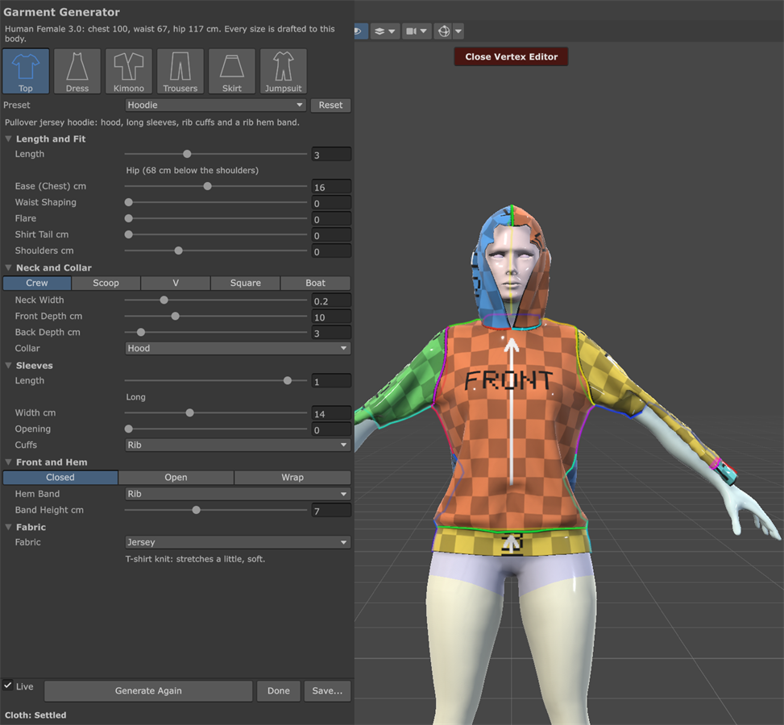

# Tutorial 3: the Garment Generator

The Garment Generator drafts a finished, sewn pattern from a garment type and a few style values, measured to the body in the designer, and drapes it while you watch. In this tutorial you make a hoodie and a dress without drawing a line, then take a generated pattern further by hand.

**Time:** about 15 minutes. **You need:** [Tutorial 1](Clothes%20Designer%20-%20Tutorial%201%20-%20Your%20First%20Garment.md), or to know how to open the designer.

Other guides: [Start Here](!Clothes%20Designer%20-%20Start%20Here.md), [Garment Generator](Clothes%20Designer%20-%20Garment%20Generator.md) (every type, preset and slider).

## When to use it

| Use the Generator when... | Use the Pattern Canvas when... |
| --- | --- |
| You want a common garment quickly: a T-shirt, jeans, a dress, a kimono. | You want a cut the Generator does not offer. |
| You want to try lengths, fits and necklines and see each one draped. | You are tracing a real sewing pattern. |
| You need a good starting pattern to change by hand. | You need full control of every piece. |

A generated pattern is an ordinary pattern. Everything in the other tutorials works on it.

## Step 1: open the Generator

1. Choose **UMA > Clothes Designer > Create Clothes on Race...**, pick **Human Female 3.0** and press **Create Clothes**.
2. In the panel's **Pattern** section, press **Generator**.

The **Garment Generator** window opens. Its first line shows the race and its chest, waist and hip: every size is drafted to this body.

> **Tip:** **UMA > Clothes Designer > Garment Generator** opens the same window. With no designer open, it offers **Create Clothes on Race...** first.

## Step 2: generate a hoodie

1. Click the **Top** tile at the top of the window. The six tiles are the garment types: **Top**, **Dress**, **Kimono**, **Trousers**, **Skirt** and **Jumpsuit**.
2. In the **Preset** popup, choose **Hoodie**. The line under it says what the preset is.
3. Press **Generate**.

The pattern is drafted to the body, laid round it and draped: a front, a back, two sleeves with rib cuffs, a rib hem band and a two-panel hood. The line at the bottom of the window follows the cloth: *Sewing*, *Settling*, *Settled*.

## Step 3: change it with the sliders

**Live** (bottom left) is on: every change is drafted and draped again as soon as you let go of the slider.

Try these, one at a time, and watch the cloth:

1. In **Length and Fit**, drag **Length** one stop shorter, from *Hip* to *High Hip*. The stops run from *Crop* and *Waist* down to *Ankle* and *Floor*, and the label under the slider says where the hem falls on this body.
2. Drag **Ease (Chest) cm** to 30. That is an oversized fit: 4 is fitted, 10 regular, 20 loose.
3. In **Sleeves**, drag **Length** down to about 0.5, the elbow.
4. In **Neck and Collar**, change **Collar** from *Hood* to *Turtleneck*, then back to *Hood*.
5. In **Front and Hem**, change the front from **Closed** to **Open**. The front becomes two pieces that meet at the middle, unsewn.

After the first change the **Preset** popup reads *Custom*, and the pattern is named after the preset it came from: *Hoodie (Custom)*.

Press **Reset** beside the preset to go back to the preset's own values.

> **Tip:** turn **Live** off to change several values first, then press **Generate Again**.

## Step 4: generate a dress

1. Click the **Dress** tile and choose the **Sundress** preset.
2. With **Live** on, the dress is drafted as soon as you choose it. With Live off, press **Generate Again**. The hoodie is replaced without a question, because you have not edited it by hand.
3. In **Length and Fit**, try **Length** at *Midi*, **Flare** at 0.8 and **Waist Shaping** at 0.6.
4. In **Neck and Collar**, try the necklines: **Crew**, **Scoop**, **V**, **Square** and **Boat**.
5. In **Fabric**, change **Fabric** from *Silk* to *Cotton* and see the folds change.

There are 39 presets in all. A few to try: **Kimono** (wrapped left over right), **Joggers** (rib waistband and ankle cuffs), **Pleated Skirt**, **Boiler Suit**.

## Step 5: finish and save

1. Press **Done**. The UVs are packed tightly. Live drafts lay the UVs out quickly, so this is worth doing before you texture the clothes. The drape is kept.
2. Press **Save...** and choose where the pattern and the fit go.

The pattern keeps its style. Open it later, press **Generator**, and the window picks up where you left off.

## Step 6: take it further by hand

A generated pattern is a starting point. Change it like any other:

1. In the panel, press **Pattern Canvas**. Every piece, seam and size the Generator made is there to edit.
2. Drag a point of the front's neckline to reshape it. The cloth on the body is rebuilt.
3. Back in the Scene view, choose the **Fit Brush** in **Cloth Tools**, pick **Hug**, and paint along a sleeve. The painted cloth is cut smaller and drawn onto the arm.

> **Note:** once you have edited a generated pattern by hand, the Generator no longer replaces it silently. **Live** stops, and **Generate** asks first, offering to save. Generating again starts from the style, so the changes you made by hand are not in the new draft.

So set the style first, and edit by hand afterwards.

## Step 7: publish

Press **Publish** on the Cloth Tools toolbar, give the clothes a **Name**, choose the **Wardrobe Region** and press **Publish**, as in [Tutorial 1](Clothes%20Designer%20-%20Tutorial%201%20-%20Your%20First%20Garment.md#step-9-publish).

## Good to know

- **Other bodies.** The Generator measures the body that is open. On *Human Male 3.0* the same preset is drafted to his measurements. His waist is hardly narrower than his hips, so skirts and wool trousers settle lower on him; a **Rib** waistband holds them higher.
- **Bands.** Cuffs, hem bands and waistbands are **Same Fabric** (as long as what they are sewn to) or **Rib** (cut shorter, so they gather the edge in and grip).
- **Tight clothes.** An ease below zero cuts the cloth smaller than the body. Use it with stretch fabrics: *Leggings*, *Crop Top*, *Catsuit*.
- **Wraps.** A wrap in *Silk* crosses through itself where the fronts overlap, because silk is too limp to stay layered. *Cotton*, *Wool* and *Fleece* wrap cleanly.

## What you learned

- Pick a type and a preset, press **Generate**, and move sliders: with **Live** on, each change drapes at once.
- **Reset** returns to the preset; **Done** packs the UVs; **Save...** saves the pattern and the fit.
- A generated pattern is an ordinary pattern. Set the style first, then edit by hand.

## Next

- Every slider explained: [Garment Generator](Clothes%20Designer%20-%20Garment%20Generator.md).
- Texture it, with a zipper down the open front: [Tutorial 4: Texturing with the Overlay Painter](Clothes%20Designer%20-%20Tutorial%204%20-%20Texturing%20with%20the%20Overlay%20Painter.md).
