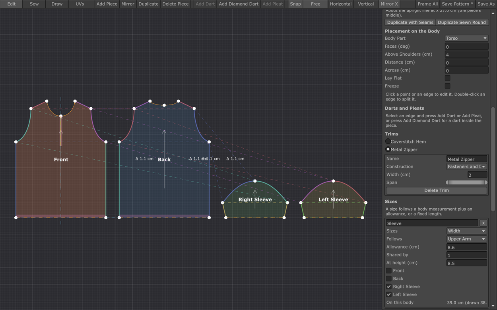
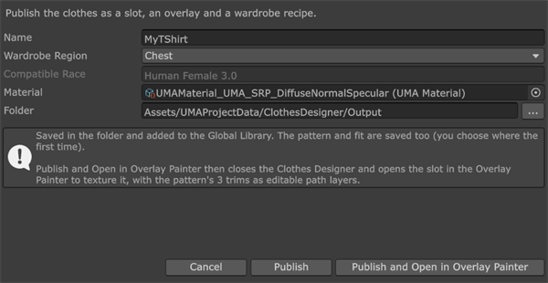
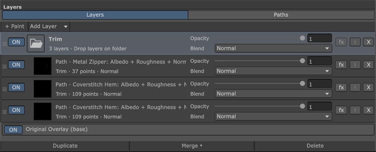
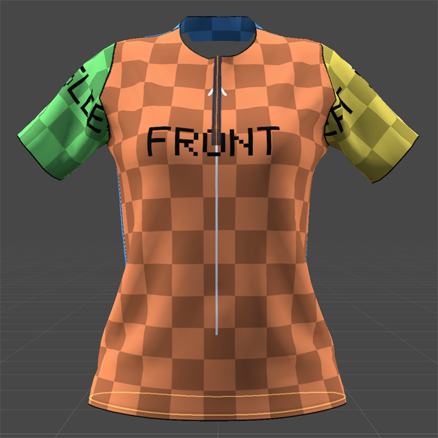

# Tutorial 4: texturing with the Overlay Painter

The Clothes Designer makes the shape of the clothes. The **Overlay Painter** paints what they look like. The two work together: on the Pattern Canvas you say *where* a zipper, a row of stitching or a hem goes, and the Overlay Painter draws it there, as a layer you can still edit.

In this tutorial you put a hem and a zipper on a T-shirt, publish it straight into the Overlay Painter, colour it, and bring the texture back to the clothes.

**Time:** about 25 minutes. **You need:** the **Overlay Painter** plugin installed (**UMA > Welcome to UMA > Plugins**), and [Tutorial 1](Clothes%20Designer%20-%20Tutorial%201%20-%20Your%20First%20Garment.md).

Other guides: [Start Here](!Clothes%20Designer%20-%20Start%20Here.md), [Pattern Canvas: Trims](Clothes%20Designer%20-%20Pattern%20Canvas.md#trims-zippers-stitching-piping-and-hems), and the Overlay Painter's own [guide](../../OverlayPainter/Documentation/OverlayPainter.md).

## How the two tools fit together

```
Clothes Designer                               Overlay Painter
----------------                               ---------------
Pattern Canvas: Add Trim on an edge or line
Publish and Open in Overlay Painter  ------->  opens the published slot and its overlay
                                               one path layer per trim, in a group named Trim
                                               paint, fill, edit the trims
                                               Save As (keeps the layers), Export (makes the textures)
Publish again later  <-----------------------  the overlay's textures are kept
```

Three things make this work:

- **Every piece has its own island in the texture**, laid out from the pieces as drawn. Draping, posing and remeshing never move a texture.
- **A trim is a place, not paint.** The pattern stores which edge or line it follows, its width and its construction. The painter draws it.
- **Publishing again keeps the overlay's textures.** Only the slot's mesh is replaced.

## Step 1: open a pattern and settle its UV layout

1. Open the designer on **Human Female 3.0** and load the **T-Shirt** sample (**Samples** in the Pattern section), or open a pattern of your own.
2. Press **Pattern Canvas** and choose the **UVs** tab on the toolbar.
3. Check the **Texture** size (the bake resolution) and that the tab says *No problems: every piece is inside its place.* If it lists pieces that left their place, press **Repack UVs**.

> **Note:** settle the layout *before* you paint. **Repack UVs** moves the islands, and a texture painted for the old layout no longer lines up. The same goes for redrawing a piece much larger.

## Step 2: put a hem on the front and the back

1. Choose **Edit** on the toolbar.
2. Click the front's **hem** edge.
3. In the side panel, under **Edge**, press **Add Trim**. A pink band appears along the hem, and a **Trims** section appears in the side panel.
4. In **Trims**, set:
   - **Construction**: *Seams and Trim > Coverstitch Hem* (the usual hem of a T-shirt).
   - **Width (cm)**: 2.
   - **Inset (cm)**: 1. Half the width keeps the whole trim just inside the edge.
   - **Span**: leave it covering the whole edge.
5. Do the same on the back's hem.

The **Construction** list is the Overlay Painter's path generators: stitches, seams and hems, piping and bound edges, zippers, lace. Choose roughly here and fine-tune in the painter.

## Step 3: draw a line and put a zipper on it

A trim follows an edge or a line drawn inside a piece. A zipper down the chest needs a line.

1. Choose **Draw** on the toolbar and **Seam Line** in the popup beside it.
2. Click the front's neckline at its centre, then click about 18 cm straight below it. Hold **Ctrl** (Cmd on a Mac) for the second click to keep the line upright.
3. Press **Enter** to finish the line.
4. Choose **Edit**, click the line to select it, and press **Add Trim** in the side panel.
5. In **Trims**, set **Construction** to *Fasteners and Distress > Metal Zipper* and **Width (cm)** to 2.



> **Tip:** a click near a point lands exactly on it (**Snap** on the toolbar shows a pink ring), so the line starts exactly at the neckline's centre point.

## Step 4: publish into the Overlay Painter

1. Go back to the Scene view, press **Simulate** and wait for *Settled*.
2. Press **Publish** on the Cloth Tools toolbar.
3. Set the **Name** and the **Wardrobe Region**.
4. Press **Publish and Open in Overlay Painter**.



The designer publishes as usual (slot, overlay, wardrobe recipe, Global Library, pattern and fit saved), closes, and opens the Overlay Painter on the published slot and its overlay.

> **Note:** the button is shown only when the Overlay Painter is installed. Without it, the Publish window has **Publish** alone.

## Step 5: meet your trims in the painter

The painter opens with three path layers in a group named **Trim**, one for each trim, drawn along its place in the slot's UVs at its width. Under them is **Original Overlay (base)**: the clothes' own overlay.





1. The **Trim** group is selected, so every trim is shown. Click one in the Scene view or the UV window to select its layer.
2. In **Overlay Painter Properties**, under **Path Generator**, change it: the zipper's teeth and colours, the stitch length, the thread colour.
3. Click the next trim. With the group's **Edit Paths Together** on (the default) you can click from one to the next.

The trims are ordinary path layers now. Move their points, change their width, or delete them, as in the painter's [Surface Paths](../../OverlayPainter/Documentation/OverlayPainter.md#surface-paths) guide.

## Step 6: colour the cloth

The slot arrives with its **UV Check Texture**: checks, outlines and piece names. Cover it with a fabric.

1. In the layer toolbar, choose **Add Layer > Fill > Empty Fill Layer**.
2. Drag the fill layer below the **Trim** group, so the trims are drawn over it.
3. Under **Active Layer > Layer Channels > Albedo**, set **Source > Type** to **Color**, or to **Texture** for a tileable fabric.

From here it is the Overlay Painter's own ground: paint layers, sprite sets, cloth generators, wear and dirt. Start with [Your First Paint Layer](../../OverlayPainter/Documentation/OverlayPainter.md#your-first-paint-layer) in its guide.

## Step 7: save the layers and export the texture

Saving and exporting are two different things in the painter.

1. **Save As** keeps the editable document: every layer, path and mask. Do this so you can come back and change the trims.
2. **Export** (on the workspace toolbar, or **File > Export...**) makes the textures the game uses. There are two ways to get them onto your clothes:

| Way | What happens | Use it when |
| --- | --- | --- |
| **Overwrite Source Overlay** | The clothes' own overlay gets the painted textures. The wardrobe recipe already uses it, so nothing else changes. The painter asks twice and keeps backups. | The clothes have one look. |
| A new overlay, with an **Export Identifier** | A new overlay asset is made beside the original. Add it to the wardrobe recipe yourself. | You want colour variants, or want to keep the original. |

See [Export Textures and UMA Assets](../../OverlayPainter/Documentation/OverlayPainter.md#export-textures-and-uma-assets) in the painter's guide for every option.

Leave the painter with **Shutdown Overlay Painter** in the Scene view.

## Step 8: check it on a character

Put the wardrobe recipe on a character, or open the designer again, open your fit with **Open Fit**, and press **Show Try-On** in the Publish section.

## Changing the clothes after painting

| You change | What happens to the texture |
| --- | --- |
| The drape, the fit, the Mesh Level, the body shape | Nothing. Publish again; the texture still fits. |
| A piece's shape a little | The piece keeps its island. Touch up the paint near the changed edge if needed. |
| A piece much larger, so it leaves its island | The Fit messages say to **Repack UVs**. After repacking, the old texture no longer lines up: open the saved painter document and export again. |
| A trim's edge or line is deleted | The trim is left out the next time, with a message. |

Publishing again under the same name keeps the overlay's textures. The UV Check Texture is only written while the overlay still holds an earlier check texture or nothing, so it never replaces your painting.

## Texturing without the painter

The designer can texture clothes by itself in three ways. They are overlays on the same slot, so they also work together with a painted texture.

- **Looks: a fabric for each piece.** On the Pattern Canvas, give a piece a **Look**: a colour texture, a normal map and a mask, tiled at their real size along the grain, with a colour a character can change at run time. With **Piece Looks** on in Publish, each look is baked as its own overlay. See [Looks](Clothes%20Designer%20-%20Pattern%20Canvas.md#looks-a-fabric-per-piece).
- **Topstitching.** Select a sewn edge on the Pattern Canvas and set **Topstitch** to *Single* or *Double*. With **Topstitching** on in Publish, the stitching is drawn along the seams in the **Thread Colour**.
- **The UV Check Texture as a guide.** `<Name>_UVCheck.png` shows every piece's outline, grain and name with 5 cm checks. Use it as a template in any paint program, then put your texture on the overlay.

## What you learned

- **Add Trim** on an edge or a line says where a zipper, a hem or stitching goes; draw a **Seam Line** where there is no edge.
- **Publish and Open in Overlay Painter** hands the slot, its overlay and the trims to the painter.
- In the painter, trims are path layers in the **Trim** group. **Save As** keeps the layers; **Export** makes the textures.
- Settle the UV layout before painting. Publishing again keeps the texture.

## Next

- Every trim and UV option: [Pattern Canvas](Clothes%20Designer%20-%20Pattern%20Canvas.md).
- Finish the clothes for a game: [Tutorial 6: Game-Ready Clothes](Clothes%20Designer%20-%20Tutorial%206%20-%20Game-Ready%20Clothes.md).
