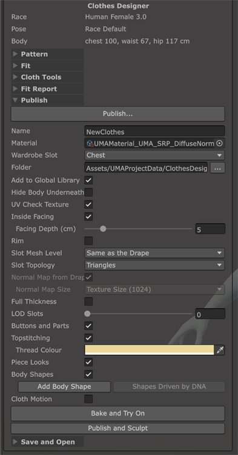

# Tutorial 6: game-ready clothes

A draped garment is not yet a game asset. It should be light, look right from every side, fit every body the race can have, and move. All of that is set in the **Publish** section before you bake. In this tutorial you take a skirt through each setting.

**Time:** about 25 minutes. **You need:** [Tutorial 1](Clothes%20Designer%20-%20Tutorial%201%20-%20Your%20First%20Garment.md).

Other guides: [Start Here](!Clothes%20Designer%20-%20Start%20Here.md), [Fitting and Publishing](Clothes%20Designer%20-%20Fitting%20and%20Publishing.md#baking) (the reference for every setting here).

## The settings at a glance

| You want | Setting | Where |
| --- | --- | --- |
| Small folds on a light mesh | **Slot Mesh Level** with **Normal Map from Drape** | Publish |
| No see-through at the neck, armholes and hem | **Inside Facing**, **Rim**, or **Full Thickness** | Publish |
| Cheaper meshes far from the camera | **LOD Slots** | Publish |
| No skin poking through | **Hide Body Underneath** | Publish |
| A fit for heavy, thin and muscular bodies | **Body Shapes** | Publish |
| Cloth that swings at run time | **Cloth Motion** | Publish |
| Good bending at the joints | **Weighting** | Vertex Editor window, Fabric |
| Hair held down under a hat or hood | **Holds Hair Down** | Publish (clothes with head pieces) |
| Quads for other tools | **Slot Topology** | Publish |

While you try settings, use **Bake and Try On** at the bottom of the Publish section (it reads **Bake Again and Try On** once the clothes have been baked). It bakes with the settings shown and puts the result on the try-on character, without asking for a name and without saving the pattern and fit. Use **Publish** when you are done.

## Step 1: load and drape a skirt

1. Open the designer on **Human Female 3.0**.
2. Press **Samples**, choose **A-Line Skirt** (in *Dresses and Skirts*) and press **Load**.
3. Press **Simulate** and wait for *Settled*.

## Step 2: fine folds on a light slot

Small folds need a fine mesh, and a fine mesh makes a heavy slot. So drape fine and bake coarse.

1. In the **Fit** section, set **Mesh Level** to **Very Fine (1 cm)**. The vertex and triangle counts are shown under it. The drape is carried over to the finer mesh.
2. Press **Simulate** and let it settle. Finer folds form.
3. In the **Publish** section, set **Slot Mesh Level** to **Medium (2 cm)**.
4. Leave **Normal Map from Drape** on.

The slot is meshed at 2 cm and takes its shape from the fine drape. The bake compares the two at every texel and writes the difference as a normal map, `<Name>_DrapeNormal.png`, so the light slot still shows the small folds.

> **Note:** **Normal Map from Drape** can only be turned on while the slot is coarser than the drape. The line under it says how the two compare.

> **Tip:** while you are still shaping the cloth, work at **Draft** or **Medium**. Raise the Mesh Level at the end; the drape is carried over.

## Step 3: close the openings

Baked clothes are one layer of cloth. With a material that hides back faces, looking up under the hem shows straight through.

- **Inside Facing** (on by default) adds a turned-in copy of the cloth inside every opening. **Facing Depth (cm)** is how far in it reaches: 5 cm suits a neckline, raise it for a hem you can see far into.
- **Rim** adds a narrow band round each opening, so the edge shows a thickness. Set **Rim Thickness (mm)**.
- **Full Thickness** gives the whole garment an inside, about twice the triangles. Use it for coats and capes seen from both sides.

For the skirt, turn on **Rim** and raise **Facing Depth (cm)** to 15.

With a double-sided material you need none of these.

## Step 4: LODs

Set **LOD Slots** to **2**.

The bake adds `<Name>_LOD1` and `<Name>_LOD2`, each meshed half again as coarse as the one before, drawn with the same overlays. A character with UMA's **Simple LOD** component swaps them in by distance.

## Step 5: hide the body underneath

Turn on **Hide Body Underneath**, and leave **Add to Global Library** on (the mesh hide needs it).

The bake makes a mesh hide for the body triangles the skirt fully covers, so skin cannot poke through when the character moves. Skin within 4 cm of an opening stays, so no holes show at the waist or the hem.

## Step 6: fit every body shape

UMA's DNA moves clothes with the body's bones, but bones do not carry all of a body's shape. On a thinner body the cloth stands off; on a heavier one the body can push through. **Body Shapes** fixes that with a blendshape for each shape.

1. Make sure **Body Shapes** is ticked (it is by default).
2. Press **Add Body Shape**. Choose a DNA in the first popup, for example *belly*, and **Top (1)** in the second.
3. Add more: *lowerWeight* at **Top (1)**, and *lowerWeight* at **Bottom (0)**.
4. Press **Bake and Try On**.

For each shape, a hidden character wears the slot, that DNA is set, the slot is moved with the body under it and relaxed, and what the bones did not do is kept as a blendshape named after the DNA: `DNA_belly_Up`, `DNA_lowerWeight_Down`. Each shape takes a second or two to fit.

5. Press **Drive Shapes from DNA**. It asks first, then adds a blendshape effect to each DNA asset, so a character's DNA sets the clothes' shape.

> **Note:** the DNA assets are shared by every character of the race. Every garment baked with the same shapes uses the same names, so one effect drives them all, and you only do this once for each shape.

## Step 7: cloth that moves

1. Turn on **Cloth Motion**.
2. Leave the three values as they are to start with:

| Setting | Meaning |
| --- | --- |
| **Held Within (cm)** | Cloth this close to the body moves only with the bones: the waistband. |
| **Swing per cm** | How far cloth may swing for each centimetre of cloth between it and where it is held. At 0.3, a hem 30 cm below the waist swings up to 9 cm. |
| **Most Swing (cm)** | The most any cloth may move from where the bones put it. |

3. Press **Bake and Try On**.

The slot gets per-vertex limits and a renderer of its own, so Unity's Cloth simulates only the skirt, not the body.

Unity Cloth simulates only in **Play mode**. To see it, put the wardrobe recipe on a character in a scene and press Play. Add UMA's **Physics Avatar** to the character so the cloth collides with the body.

## Step 8: choose how the clothes are weighted

In the Vertex Editor window, open **Fabric** and find **Bone Weights (this fit)**.

| Weighting | Use it for |
| --- | --- |
| **Robust Inpaint** (the default) | Most clothes. Copies the body where the cloth lies on it and fills the rest in smoothly, so a hem between the legs follows both legs. |
| **Tight Surface** | Skin-tight clothes. |
| **Volumetric** | Long skirts, gowns and capes. |
| **Simulated Fit** | Clothes that move away from the body and back. The bake drapes the clothes in test poses first, so it takes longer. |
| **Auto** | Tries three methods in test poses and keeps the best. |

Hover over a method for when to use it. **Weights from Torso Only** keeps a vest's side from following the arm next to it; sleeves always take their weights from the arms. The methods are explained in [Copying Bone Weights to Clothes](../../Docs/WeightTransfer.md).

After baking, check the result on the try-on: **Arms Raised** for tops, and a walk or run clip in **Try-On Animation** for skirts and trousers.

## Step 9: publish

Press **Publish**, set the **Name** and **Wardrobe Region** (*Legs* for a skirt), and press **Publish**.

Read the messages under the bake buttons. They point out vertices far from the body, a material that hides back faces, and how much detail the normal map carries.

## Two more settings

- **Holds Hair Down** appears for clothes with pieces laid round the head (a beanie, a hood). The bake publishes a clipping plane across the hat's opening, and UMA squashes hair under it when the character is built. Press **Check Hair...** to list hair slots that will not be held down, and fix them.
- **Slot Topology** set to **Quads** or **All Quads** meshes the slot in quads along each piece's grain, and can write `<Name>_Quads.obj` for Blender and other tools.

## A checklist before you ship

1. The **Fit Report** shows nothing in the body.
2. **Arms Raised** and a **Try-On Animation** show no skin poking through.
3. The slot's triangle count (in the *Baked ...* message) suits your game, and **LOD Slots** are set.
4. Looking into every opening shows cloth, not the background.
5. **Body Shapes** cover the DNA your characters use.
6. The pattern and the fit are saved, so you can change the clothes later.

## What you learned

- Drape fine, bake coarse: **Slot Mesh Level** and **Normal Map from Drape**.
- **Inside Facing**, **Rim** and **Full Thickness** close the openings.
- **LOD Slots**, **Hide Body Underneath**, **Body Shapes** and **Cloth Motion** are one tick each.
- **Bake and Try On** tests settings; **Publish** finishes.

## Next

- Every bake setting in detail: [Fitting and Publishing](Clothes%20Designer%20-%20Fitting%20and%20Publishing.md#baking).
- Texture the clothes: [Tutorial 4: Texturing with the Overlay Painter](Clothes%20Designer%20-%20Tutorial%204%20-%20Texturing%20with%20the%20Overlay%20Painter.md).
